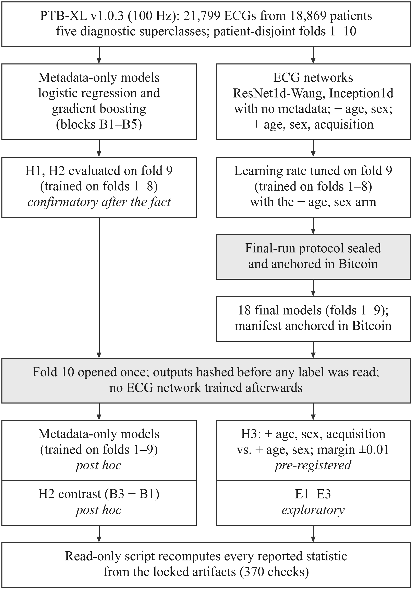
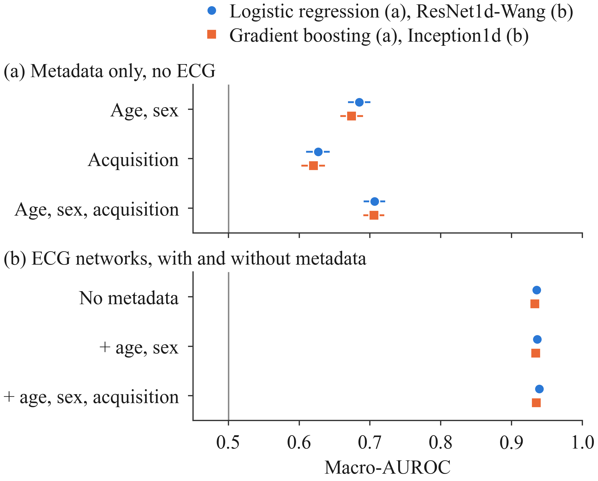
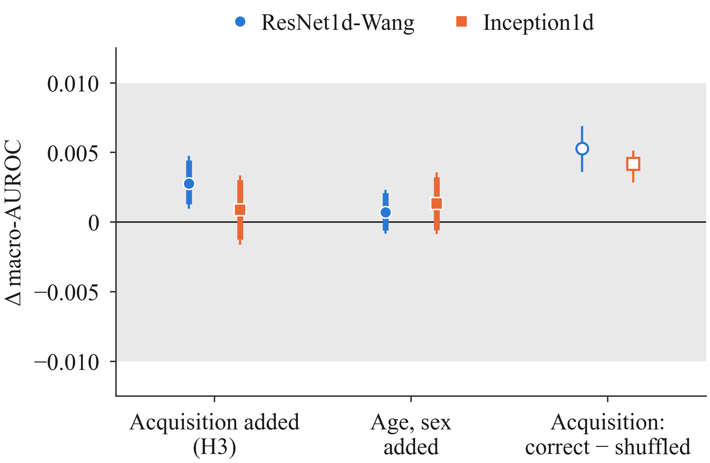

# Auditing Acquisition Metadata Effects on ECG Classification in PTB-XL

Code, write-once protocol documents with Bitcoin timestamp proofs, and the verification script for the paper

> I. Aghajanzadeh and M. Sepahvand, "Auditing Acquisition Metadata Effects on ECG Classification in PTB-XL," submitted to the 12th International Conference on Signal Processing and Intelligent Systems (ICSPIS 2026), Shahrood University of Technology, Iran.

## What the study asks

PTB-XL gives every ECG the patient's age and sex as well as the recording **device**, **site** and **nurse**. On the five diagnostic superclasses (NORM, MI, STTC, CD, HYP), we ask two questions:

1. How much of the macro-AUROC can be reproduced from metadata alone, without the ECG?
2. Does adding acquisition metadata (device, site, nurse) change the test macro-AUROC of an ECG network that already receives age and sex? This question is tested under a **pre-registered** two-sided protocol with a ±0.01 equivalence margin.

## Main results (test fold 10)

| | macro-AUROC or Δ [95% CI] | status |
|---|---|---|
| Metadata only (age, sex, device, site, nurse), logistic regression | 0.7065 [0.6910, 0.7213] | post hoc |
| ResNet1d-Wang: (signal + all) − (signal + age/sex) | +0.0028 [+0.0010, +0.0048]: statistically detectable, below the materiality threshold | pre-registered (primary) |
| Inception1d: (signal + all) − (signal + age/sex) | +0.0009 [−0.0016, +0.0033]: no material change | pre-registered (robustness) |

Every value reported in the paper, including all intervals that the paper refers to the repository for, is listed in [`RESULTS.md`](RESULTS.md).

## Figures

Figure numbers follow the paper. Each PNG is the 600-dpi raster written next to the vector PDF that the paper uses. The files of Fig. 2 and Fig. 3 keep their original names (`fig1_auroc_levels`, `fig2_delta`) because their hashes are recorded; the flowchart was added to the paper later.

<p align="center">
  
</p>

**Fig. 1.** Study design. Left: metadata-only models; right: ECG networks. Shaded boxes are the two provenance gates: the final-run protocol was anchored before the first network with acquisition metadata was trained, and fold 10 was opened once, after the manifest of the 18 final models had been anchored. Italic lines give the status of each analysis. B1–B5: metadata blocks; E1–E3: exploratory analyses (both are listed in [`RESULTS.md`](RESULTS.md)). Vector version: [`flowchart.pdf`](outputs/figures/flowchart-1.1_20261009-202513/flowchart.pdf).

<p align="center">
  
</p>

**Fig. 2.** Macro-AUROC over the five diagnostic superclasses on the test fold (fold 10). (a) Metadata-only models trained on folds 1–9 (post hoc); gradient boosting values and intervals are means over three seeds. Acquisition metadata: recording device, site and nurse. (b) ECG networks (three-seed ensembles) without metadata, with age and sex, and with age, sex and acquisition metadata. Horizontal lines: 95% patient-level bootstrap intervals (2,000 resamples); in (b) they are narrower than the markers. Vertical line: chance level. Vector version: [`fig1_auroc_levels.pdf`](outputs/figures/run_20261008-022605/fig1_auroc_levels.pdf).

<p align="center">
  
</p>

**Fig. 3.** Change in test-fold macro-AUROC. Left: adding acquisition metadata to an ECG network that already receives age and sex (pre-registered H3; ResNet1d-Wang primary, Inception1d robustness). Middle: adding age and sex to the ECG-only network (exploratory). Right: correct minus shuffled acquisition metadata, mean (hollow marker) and range over 20 shuffles (exploratory). Thick and thin bars: 90% and 95% patient-level bootstrap intervals (2,000 resamples). Shaded band: ±0.01, the pre-registered smallest effect size of interest for H3. Vector version: [`fig2_delta.pdf`](outputs/figures/run_20261008-022605/fig2_delta.pdf).

## Repository layout

The repository mirrors the project folder as it was run, so the relative paths used by the code and recorded in the manifests remain valid.

```
preregistration/   write-once protocol documents and their .ots proofs
                   (pre_registration, dev_protocol, v0.5_training_details, lr_selection, final_run_protocol)
notebooks/         the code of every stage, in run order (see table below)
outputs/<stage>/   the outputs of each stage, including its manifest; the remaining locked documents live here:
                   outputs/v0.8/v0.8_manifest.json, outputs/v0.9/v0.9_{frozen_outputs,results,manifest}.json (+ .ots)
outputs/ph1_failed_1/  a failed attempt kept on purpose (see Deviations)
outputs/verify/run_20261008-022605/   verify.py output: paper_numbers.json, tables, report
outputs/figures/run_20261008-022605/  Fig. 2 and Fig. 3 (files fig1_*, fig2_*: PDF, PNG, TIFF) and their manifest
outputs/figures/flowchart-1.1_20261009-202513/
                   Fig. 1, the study-design flowchart (PDF, PNG), its layout and manifest
tools/             check_locked_hashes.py
RESULTS.md         all tables, generated from paper_numbers.json
```

| stage | code (`notebooks/`) | what it does |
|---|---|---|
| v0.1.x | `ptbxl_metadata_audit_v0.1.1.ipynb`, `ptbxl_metadata_audit_v0.1.2.ipynb`, `ptbxl_metadata_audit_v0_1.py` | data audit: column inventory, metadata-by-fold cross-tabulations, metadata–label prevalence and association tests (folds 1–9) |
| v0.2.x | `ptbxl_death_experiment_v0.2.ipynb`, `ptbxl_death_experiment_v0.2.1.ipynb` | metadata-only models on folds 1–8 → fold 9 (the go/no-go "kill" experiment of the project; nothing to do with mortality) |
| v0.3 | `ptbxl_v0.3_preregistration.ipynb`, `ptbxl_v0.3_preregistration_cell.py` | H2 bootstrap on fold 9; pre-registration |
| v0.4 | `ptbxl_v0.4_signal_pipeline (1).ipynb` | signal pipeline (100 Hz, per-lead standardization), integrity checks, compute budget |
| v0.5 | `ptbxl_v0.5_lr_selection.ipynb` | learning-rate selection on fold 9 |
| v0.6 | `ptbxl_v0.6_final_run_protocol.ipynb` | writes the final-run protocol |
| v0.7 | `ptbxl_v0.7_dev_matrix.ipynb` | development matrix: 2 architectures × 3 arms × 3 seeds on folds 1–8, evaluated on fold 9 |
| v0.8 | `ptbxl_v0.8_final_training.ipynb` | the 18 final models on folds 1–9 and their manifest |
| v0.9 | `ptbxl_v0.9_fold10_evaluation.ipynb`, `v0.9_cell.py` (+ `.ots`) | the single opening of fold 10: H3, E1–E3 |
| ph1 | `ph1_cell.py`, `ptbxl_ph1_posthoc_metadata_fold10.ipynb`, `ptbxl_ph1_posthoc_metadata_fold10 new.ipynb`, `ph1_synthetic_harness.py` | post hoc metadata-only models on fold 10. `ph1_cell.py` is the reported revision r2 (its hash is checked by verify.py). The two notebooks hold the two runs of the cell: the first attempt (r1, stopped at the reproduction gate) and the reported run (r2); the `CODE_REVISION` line in each identifies it. The harness tests the cell on synthetic data. |
| verify | `verify.ipynb`, `verify.py` | read-only recomputation of every reported statistic (370 checks) |
| figures | `make_figures.ipynb`, `make_figures.py` | Fig. 2 and Fig. 3 from paper_numbers.json |
| flowchart | `make_flowchart.ipynb`, `make_flowchart.py` | Fig. 1, the study-design flowchart; the numbers in its boxes are read from paper_numbers.json, and nothing is written if one of its layout self-checks fails |

Not included: PTB-XL itself (see *Data*), the cached signal array `outputs/v0.4/v0.4_signals_folds1to9_100hz.npy` (regenerated by the v0.4 notebook from PTB-XL), and internal working notes.

## Write-once documents and Bitcoin anchors

Each document below is a write-once JSON file. Its SHA-256 hash is anchored in the Bitcoin blockchain with [OpenTimestamps](https://opentimestamps.org); the `.ots` proof sits next to the file. Times are UTC+03:30.

| document | role | file SHA-256 | Bitcoin block | block time |
|---|---|---|---|---|
| `pre_registration.json` | sealed pre-registration: H1-H3, fold-10 analysis plan, SESOI | `11dd446272654fc80d65b2fdd40259fa674bbb419a44fde84e589b6e297cde32` | 969577 | 2026-10-02 |
| `dev_protocol.json` | development protocol: training recipe, lr grid, sanity gate | `babf101c1d69b322daef6907175fdc4c17b5a53755a68f13a998eefa0148dc2d` | 969577 | 2026-10-02 |
| `v0.5_training_details.json` | training / evaluation implementation details | `6480c191aeaed9ff1e6b1da5caa0c1e46908d453d30106a32beb7cf83678be11` | 969577 | 2026-10-02 |
| `lr_selection.json` | learning-rate selection on fold 9 (signal_plus_physio, seed 42) | `358d783b37bba6fcf61237a43817c1fd8594fe192f8ecdfca2c25b871a21415b` | 969577 | 2026-10-02 |
| `final_run_protocol.json` | final-run and fold-10 analysis protocol (bootstrap, H3 decision, closed list) | `e1a5260e72d2e8b0d27dc709639468b7f9a48a7c8e2f8af2d663e105dbd329d4` | 969584 | 2026-10-02 15:21:18 |
| `v0.8_manifest.json` | final models: state_dict hashes, written before fold 10 was opened | `9725a0ee502784ffc267b1021ec3cb427966708205db9a09ce7e8c1fc8f30415` | 969763 | 2026-10-04 00:48:05 |
| `v0.9_frozen_outputs.json` | fold-10 model outputs frozen before any label was read | `133ca5fe9c9faf299cec5270483eb6ac2abf568a1c6fcc6bb5998d351528867f` | 969863 | 2026-10-04 |
| `v0.9_results.json` | fold-10 H3 and exploratory results | `8996ac975f7091fd07d0127521d8413e14e957f878a930334fdf69983bbc506f` | 969863 | 2026-10-04 |
| `v0.9_manifest.json` | v0.9 run manifest (every v0.9 output file hash) | `710e3519bbb750fc427cf9bafe2f6075806610401d1f52f7682f1670417cdca6` | 969863 | 2026-10-04 |

**What the anchors show:**
- The final-run protocol was anchored before the first signal + all model was trained.
- The manifest of the 18 final models was anchored before fold 10 was opened.
- The four earliest documents were anchored on 2 Oct 2026, **after** the first training runs. For them, the anchor proves existence by that date. Their ordering relative to training rests on the hash chain and the internal timestamps.

## How to verify

1. **Hashes.** Run `python tools/check_locked_hashes.py` from the repository root. It recomputes the SHA-256 of every locked document, `paper_numbers.json`, `make_figures.py` and the two figure PDFs, and compares each with the recorded value. It needs only the Python standard library.
2. **Timestamps.** Drop a document and its `.ots` file on <https://opentimestamps.org>, or run `ots verify <file>.ots` with the [OpenTimestamps client](https://github.com/opentimestamps/opentimestamps-client), which by default queries a local Bitcoin node.
3. **Numbers.** `verify.py` is read-only. It re-fits the metadata-only models, recomputes every reported statistic from the frozen network outputs, labels and locked documents, and checks every hash chain. It does not retrain the ECG networks.
   - Put `ptbxl_database.csv` and `scp_statements.csv` of PTB-XL v1.0.3 into `data/ptb-xl-a-large-publicly-available-electrocardiography-dataset-1.0.3/` (the ECG records themselves are not needed).
   - Use the environment below: the first checks compare the package versions.
   - Run, with the path of your copy of this repository:

     ```
     python notebooks/verify.py --root <path-to-this-repository>
     ```

     It takes about 5 minutes on a laptop CPU and writes a new folder `outputs/verify/run_<timestamp>/` (it never overwrites anything). The expected last line is `ALL CHECKS PASSED (370) | SKIP 0 | paper_final True`.
   - The paper's run is `outputs/verify/run_20261008-022605/`; its `paper_numbers.json` has SHA-256 `e540d16d65d9247669e8488bcc834ea854cdd5bf94f0181f3c9ceb6ff49e524c`. On 8 Oct 2026, `verify.py` was re-run on a fresh copy of this repository, with only the two CSV files added, and again passed all 370 checks.
4. **Figures.** `python notebooks/make_figures.py --root <path-to-this-repository> --run run_<timestamp>` redraws Fig. 2 and Fig. 3 from the `paper_numbers.json` of that verify run into `outputs/figures/run_<timestamp>/`. It uses the Times New Roman font file (`C:\Windows\Fonts\times.ttf`).

   `python notebooks/make_flowchart.py --root <path-to-this-repository>` redraws Fig. 1 into a new folder `outputs/figures/flowchart-1.1_<timestamp>/`. It reads only the paper's `paper_numbers.json` and checks its hash. It uses Times New Roman when installed and otherwise a similar serif font, with a warning. The paper's run, `outputs/figures/flowchart-1.1_20261009-202513/`, records in `flowchart_manifest.json` the SHA-256 of `make_flowchart.py`, of `paper_numbers.json` and of every output file.

**Re-running a stage.** Each stage cell sets `PROJECT_ROOT = r"D:\ptbxl-metadata-audit"` near its top; change it to your copy. Stages write once into their own output folder and stop rather than overwrite, so move the existing outputs of that stage aside first. Stages that use the ECG signal need the records (`records100/`) and, for training, a GPU.

Git must not change line endings, or the hashes break. `.gitattributes` therefore disables every conversion (`* -text`).

## Data

PTB-XL v1.0.3 is available on PhysioNet: <https://physionet.org/content/ptb-xl/1.0.3/>. It is licensed CC BY 4.0. This repository does not redistribute the ECG records or the database files. Unzip your own copy into `data/`, so that the database file is at `data/ptb-xl-a-large-publicly-available-electrocardiography-dataset-1.0.3/ptbxl_database.csv` (the layout used in the project). `data/` is ignored by git. `verify.py` checks the SHA-256 of both CSV files, so it needs exactly version 1.0.3.

Please cite both the dataset and PhysioNet:

- P. Wagner et al., "PTB-XL, a large publicly available electrocardiography dataset," *Sci. Data*, vol. 7, Art. no. 154, 2020.
- A. L. Goldberger et al., "PhysioBank, PhysioToolkit, and PhysioNet," *Circulation*, vol. 101, no. 23, pp. e215–e220, 2000.

## Environment

The analysis ran on Windows 10 with:
- Python 3.10.20
- numpy 1.26.4, pandas 2.3.3, scipy 1.15.3, scikit-learn 1.7.2
- matplotlib 3.10.9 and Pillow 12.3.0 (figures)
- PyTorch 2.7.1 (CUDA 11.8) for the ECG networks; training used a single 6-GB laptop GPU

`requirements.txt` lists the packages of the project environment.

## Deviations and disclosures

These are also stated in the paper.
- **H1 and H2 are confirmatory after the fact.** Their fold-9 statistics had been seen in an initial feasibility run before the pre-registration was written. The ±0.02 H2 margin was set after the fold-9 deltas were seen.
- **All fold-10 metadata-only results are post hoc.**
- **Exposure before opening.** Fold-10 marginal label counts and metadata distributions were displayed during data auditing before fold 10 was opened. No model output and no metadata–label relation was computed on fold 10.
- **Bootstrap size.** The bootstrap uses 2,000 resamples, not the 10,000 originally planned.
- **Per-class results (E2) are uncorrected** for multiplicity.
- **Metadata-only seeds.** The seeds {42, 123, 2024} come from the v0.2.1 manifest, not from a locked document.
- **Reproduction gate.** In the post hoc metadata-only run, a scipy version change altered the logistic-regression acquisition-only rows by at most 3e-6 AUROC. The first attempt therefore stopped at the reproduction gate. It is kept in `outputs/ph1_failed_1`. The tolerance was then fixed and recorded before fold 10 was used.

## License

The code is released under the MIT License (see `LICENSE`). Model outputs on PTB-XL records are derived from PTB-XL and are shared under CC BY 4.0.

## Citation

See `CITATION.cff`. The paper reference will be updated after review.
